<p align="center"></p>

<h1 align="center">GazaBridge 🇵🇸</h1>

<p align="center">
A desktop app for working with databases and moving data between them, written in Rust.<br>
MongoDB, PostgreSQL, MySQL / MariaDB and SQLite: explore, query, export, copy, convert, validate, back up and sync.
</p>

<p align="center">
<a href="https://github.com/sabahya3/GazaBridge/releases/latest/download/GazaBridge-macos-universal.dmg"></a>
<a href="https://github.com/sabahya3/GazaBridge/releases/latest/download/GazaBridge-Setup-windows-x86_64.exe"></a>
<a href="https://github.com/sabahya3/GazaBridge/releases/latest/download/GazaBridge-linux-x86_64.AppImage"></a>
</p>

<p align="center">
<a href="https://github.com/sabahya3/GazaBridge/releases/latest"></a>
<a href="LICENSE"></a>


</p>

<p align="center"><b>English</b> · <a href="README.ar.md">العربية</a></p>

<p align="center">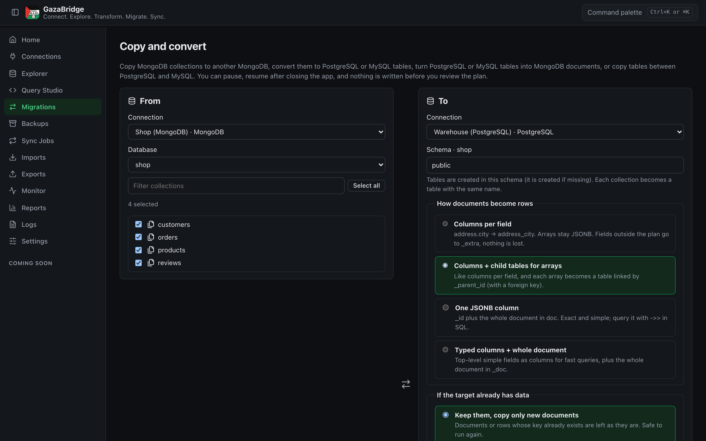</p>

GazaBridge connects to MongoDB, PostgreSQL, MySQL / MariaDB and SQLite, lets you browse and edit the data, run queries, and export or import files. It can also copy whole databases, convert MongoDB collections into SQL tables and back, check that a copy is complete, take backups and keep a target in sync. Everything runs on your computer: there is no account, no server and no telemetry. The interface is in English and Arabic (right to left).

> [!IMPORTANT]
> **Version 0.1.0, an early version. Everything was tested on macOS only** (a Mac with Apple Silicon, macOS 26).
> The code is written for Windows and Linux too, and GitHub Actions builds them, but nobody has run those builds on a real Windows or Linux computer yet. If you try one, please [open an issue](../../issues) with what happened.

## Download

From the [**Releases**](../../releases/latest) page:

| System | File | How to run |
|---|---|---|
| **macOS** 11+ (Apple Silicon and Intel) | [`GazaBridge-macos-universal.dmg`](https://github.com/sabahya3/GazaBridge/releases/latest/download/GazaBridge-macos-universal.dmg) | Open it and drag **GazaBridge** to Applications. The first time, right-click it → **Open**, because the app isn't notarized by Apple. **Tested.** |
| **Windows** 10 / 11 | [`GazaBridge-Setup-windows-x86_64.exe`](https://github.com/sabahya3/GazaBridge/releases/latest/download/GazaBridge-Setup-windows-x86_64.exe) | Installer: open it and click Next. Also as an `.msi`. **Not tried on a real Windows computer yet.** |
| **Linux** (x86_64) | [`GazaBridge-linux-x86_64.AppImage`](https://github.com/sabahya3/GazaBridge/releases/latest/download/GazaBridge-linux-x86_64.AppImage) | `chmod +x` it and run it. Also as a `.deb`. Needs WebKitGTK 4.1. **Not tried on a real Linux computer yet.** |

- If macOS says the app "is damaged and can't be opened", run `xattr -dr com.apple.quarantine /Applications/GazaBridge.app` once.
- If Windows shows a SmartScreen warning, click **More info** → **Run anyway**. The app is new and unsigned.
- Some features use tools installed separately: `mongodump` / `mongorestore` (MongoDB Database Tools) and `pg_dump` / `pg_restore` (PostgreSQL client). GazaBridge finds them and tells you how to install them if they're missing.

## What it does

### Connections
- MongoDB (including Atlas and `mongodb+srv://`), PostgreSQL, MySQL, MariaDB and SQLite.
- Paste a connection string or fill in the form; **Test** before saving.
- TLS options for each engine, and **SSH tunnels** for PostgreSQL, MySQL and MongoDB (password, key file or SSH agent, with host-key checking).
- Passwords are kept in the system's secure store (macOS Keychain, Windows Credential Manager, Linux Secret Service) or only for the session. They're never written to GazaBridge's own files, logs or process arguments.

### Explorer and editor
- A tree of databases, schemas, collections and tables with counts.
- Data as a table, JSON or a tree, page by page.
- A query bar for MongoDB: a visual builder or mongosh-style text, with sort, projection, skip and limit, plus aggregation pipelines.
- Edit, insert and delete documents and rows, with a preview of the change first and an audit log afterwards.

### Query Studio
- MongoDB and SQL queries with history, saved queries, parameters, **Cancel** and **Explain**.

### Files
- **Export** to JSON, JSONL, BSON, CSV and Excel (`.xlsx`), optionally gzip. The export follows the current query (filter, projection, sort, skip, limit).
- **Import** from JSON, JSONL, BSON and CSV. Bad records are skipped or put aside in a quarantine file, with line numbers.

### Copies and conversions
- **MongoDB → MongoDB**: whole databases, with indexes, views, collection options and validation rules.
- **MongoDB → PostgreSQL or MySQL**, in four ways: the whole document in one JSON column, **flattened** columns (`address.city` → `address_city`), **normalized** child tables for arrays, or a hybrid of typed columns plus the whole document. ObjectIds stay ObjectIds, and nothing is dropped silently: values that don't fit go to an `_extra` column.
- **PostgreSQL or MySQL → MongoDB**: a document per row, with child tables embedded as arrays or kept as references. Tables made by the flatten and normalize modes come back **as the original documents** (nested objects, arrays, ObjectIds, 32-bit numbers), including rows added later in SQL.
- **Table copies** between PostgreSQL and MySQL (and within each).
- Every copy is planned first: you see the tables, columns, types, sample rows and the exact statements before anything is written. **Dry run** goes through everything without writing.
- Pause, resume (even after closing the app), retries, and a quarantine for records that fail.

### Validation, monitoring and reports
- After a copy: count, key and **deep** (checksum) validation, naming each record that differs.
- A **Monitor** page with records per second, time left, and what's slowing the copy down.
- **Reports** for every run as HTML, Markdown, JSON or CSV.

### Backups and sync
- Backups and restores in GazaBridge's own format (with a manifest and SHA-256) for MongoDB, PostgreSQL and MySQL, or with `mongodump` / `pg_dump`. A backup is taken automatically before a copy replaces existing data.
- **Continuous sync** after a copy: MongoDB change streams, or polling a timestamp column for any source. Pause, resume and stop from the **Sync Jobs** page.

## Copy routes

Pick a source and a target on the **Migrations** page. Every route shows a plan with a preview before anything is written, and can be checked afterwards (counts, every key, or a deep checksum compare).

| From ↓ · To → | MongoDB | PostgreSQL | MySQL / MariaDB |
|---|:---:|:---:|:---:|
| **MongoDB** | ✅ copy | ✅ convert (4 ways) | ✅ convert (4 ways) |
| **PostgreSQL** | ✅ convert | ✅ table copy | ✅ table copy |
| **MySQL / MariaDB** | ✅ convert | ✅ table copy | ✅ table copy |

SQLite is supported for browsing, queries, export and import, but not yet as a copy source or target.

### MongoDB → MongoDB

The same server or another one, into the same database name or a new one. Indexes, views, collection options and validation rules come along.

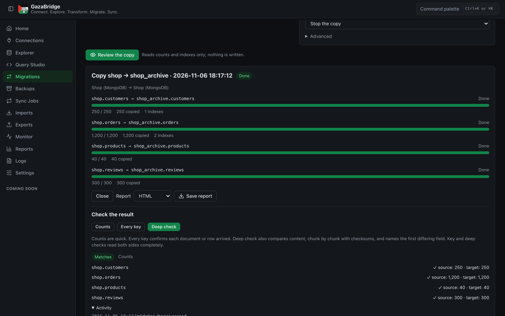

### MongoDB → PostgreSQL or MySQL: four ways to turn documents into rows

| Way | What you get | |
|---|---|---|
| **Columns per field** | `address.city` → `address_city`. Arrays stay as JSON. Fields outside the plan go to `_extra` | [screenshot](docs/screenshots/11-mode-columns.png) |
| **Columns + child tables for arrays** | Like the first, and each array becomes its own table linked by `_parent_id` (e.g. `orders` + `orders_items`) | [screenshot](docs/screenshots/05-migration-plan.png) |
| **One JSON column** | `_id` plus the whole document in `doc`. Exact and simple | [screenshot](docs/screenshots/12-mode-jsonb.png) |
| **Typed columns + whole document** | Top-level simple fields as columns for fast queries, plus the whole document in `_doc` | [screenshot](docs/screenshots/13-mode-hybrid.png) |

| | |
|---|---|
| 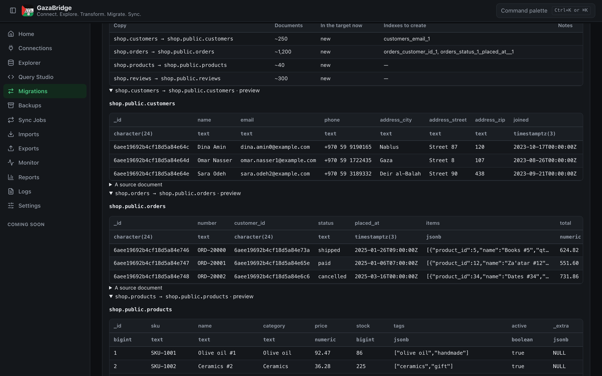 **Columns per field** | 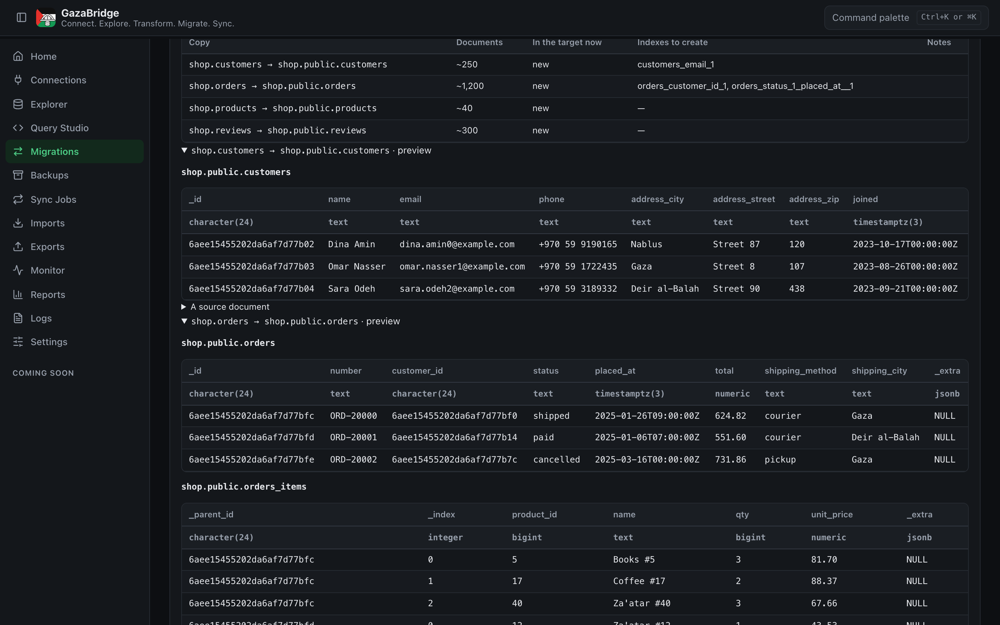 **Columns + child tables for arrays** |
| 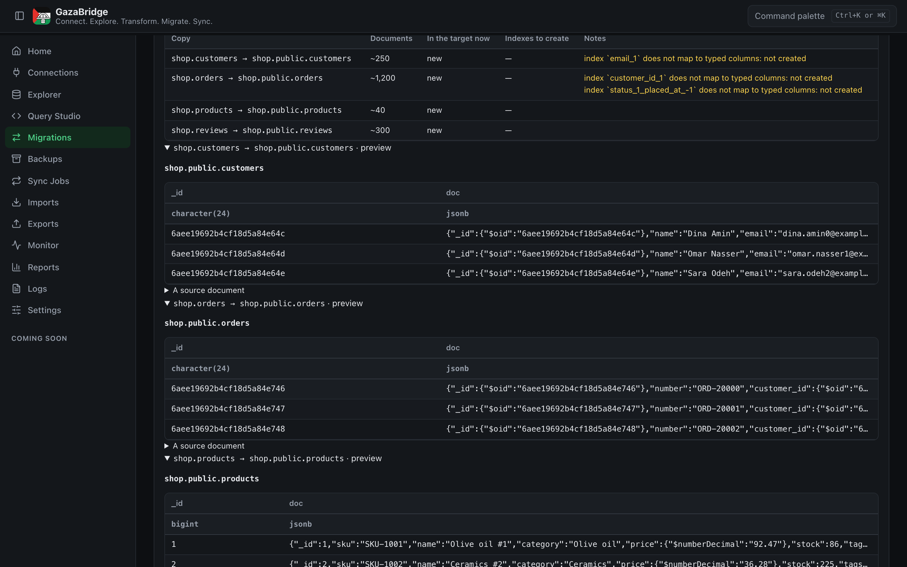 **One JSON column** | 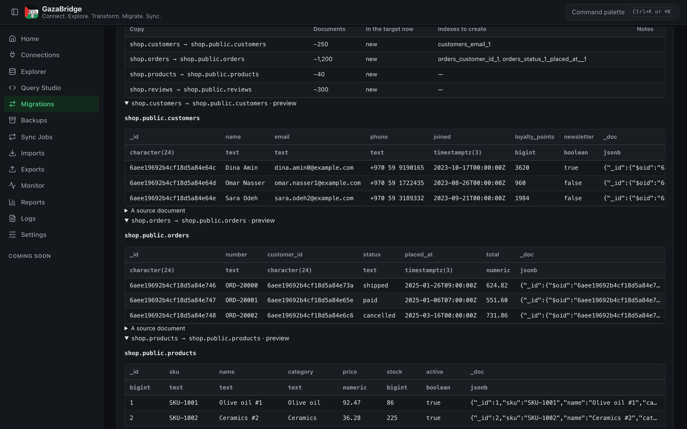 **Typed columns + whole document** |

### PostgreSQL or MySQL → MongoDB

One collection per table, or **embed related tables**: rows that reference another selected table go inside its documents as an array. Tables that GazaBridge made from MongoDB (columns or child tables) come back **as the original documents**: nested objects, arrays and ObjectIds.

| | |
|---|---|
| 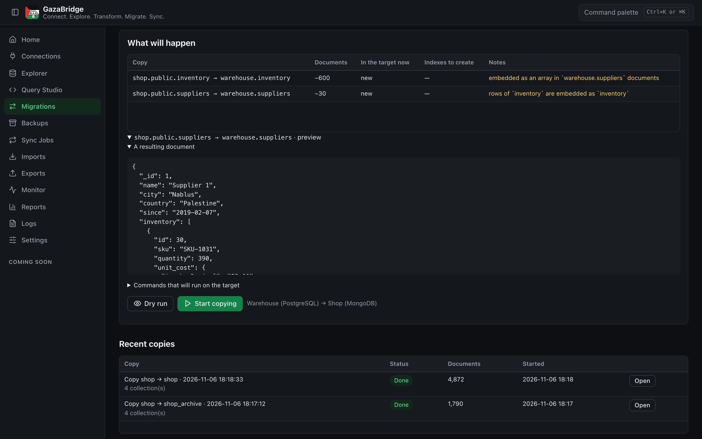 **`suppliers` + `inventory` → one document per supplier with an `inventory` array** | 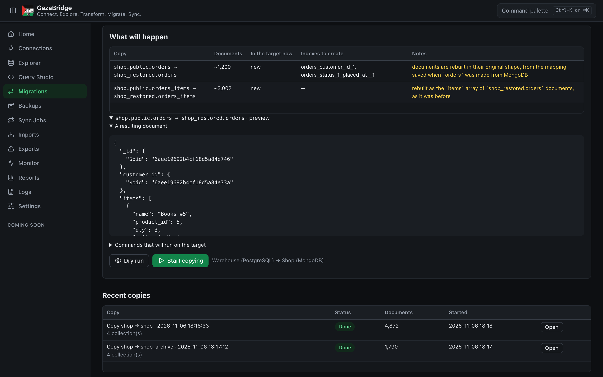 **`orders` + `orders_items` → the original `orders` documents with their `items` array** |

### PostgreSQL ⇄ MySQL

Tables are copied with matching types (for example `text` in a key becomes `varchar` in MySQL), primary keys and indexes, in either direction or within the same engine. Foreign keys are not copied yet.

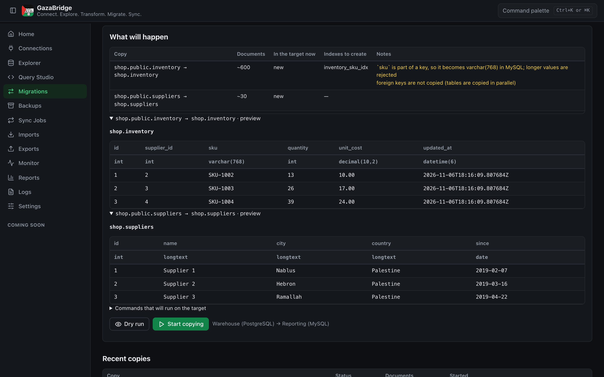

## Screenshots

The screenshots use made-up sample data in local test databases.

| | |
|---|---|
| 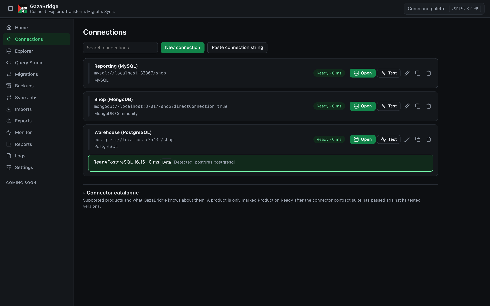 **Connections, each tested with one click** | 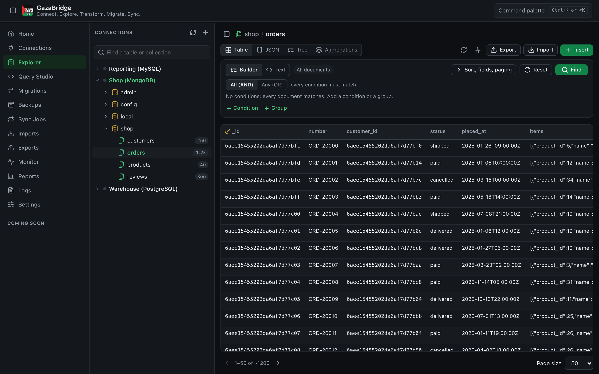 **Browse and filter a MongoDB collection** |
| 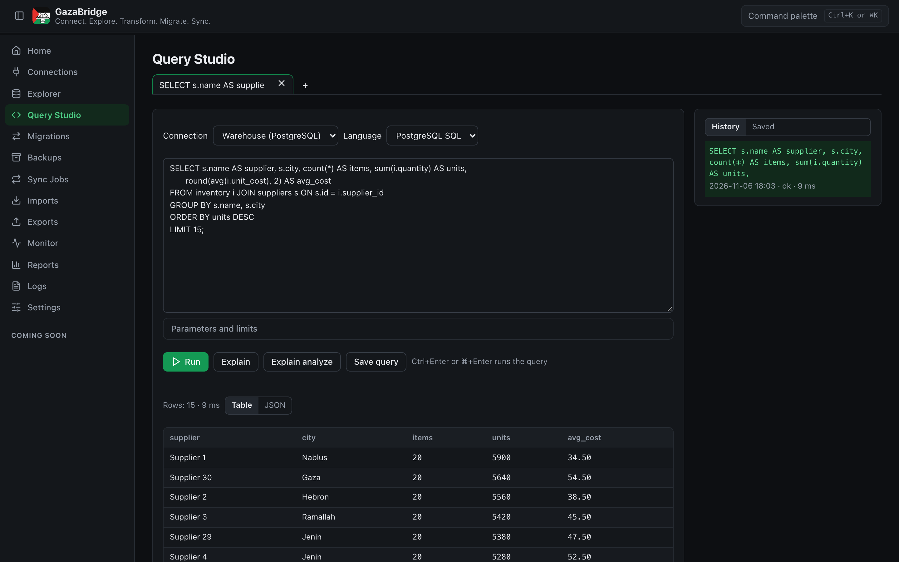 **Query Studio: SQL with results and history** |  **Copy MongoDB to PostgreSQL: choose how documents become rows** |
|  **The plan: target tables and a preview, before anything is written** | 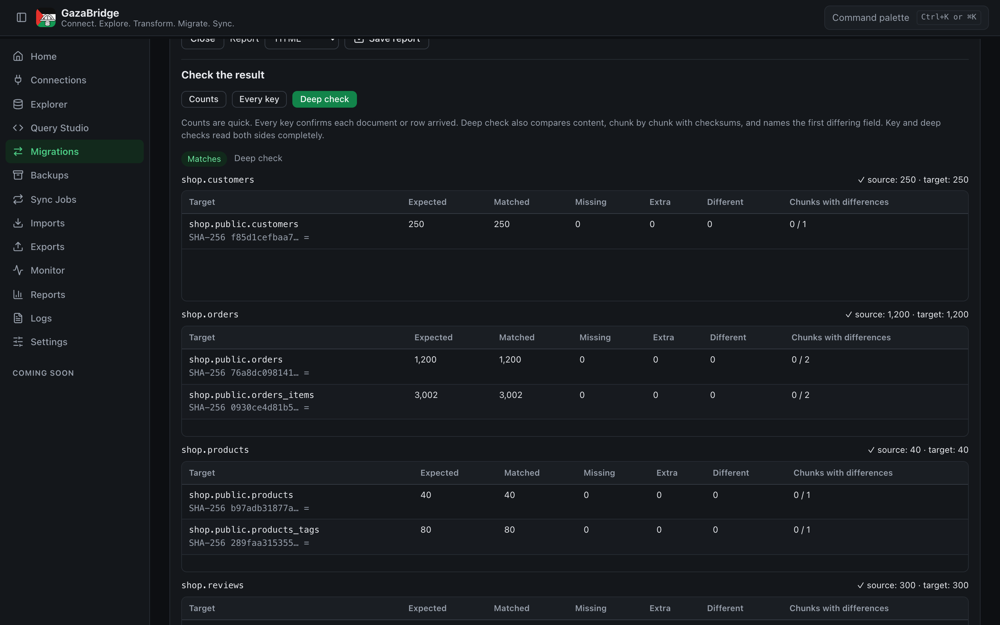 **Deep check: every row compared with checksums** |
| 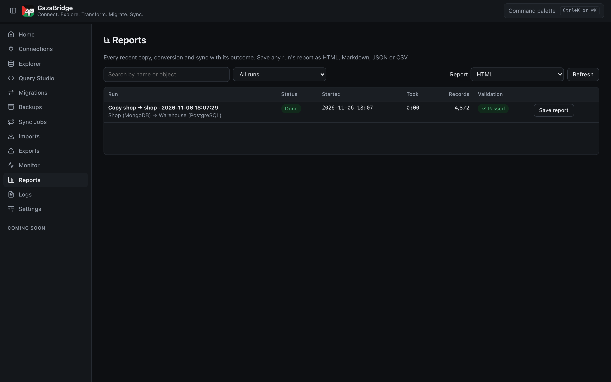 **Reports for every copy** | 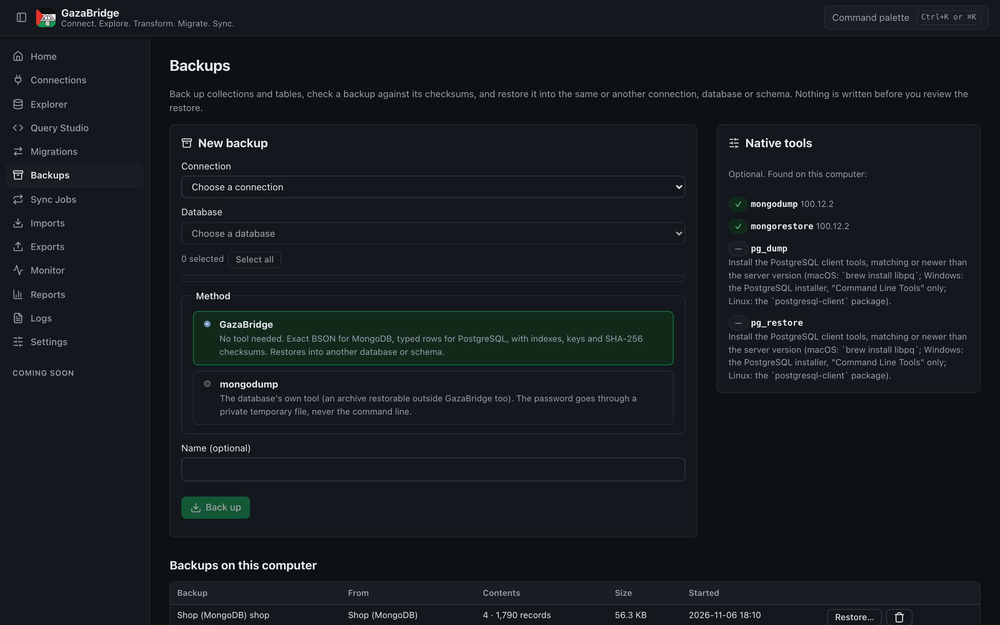 **Backups with checksums, and restore** |
| 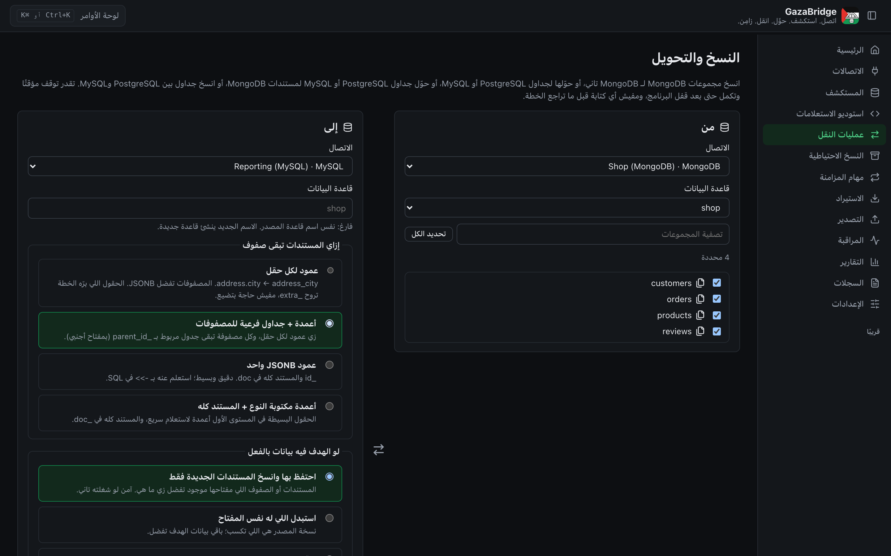 **Arabic interface, right to left** | |

## Supported databases

| Database | Versions tested |
|---|---|
| MongoDB | 6.0, 7.0, 8.0 |
| PostgreSQL | 13, 14, 15, 16, 17 |
| MySQL | 8.0, 8.4 |
| MariaDB | 10.11, 11.4 |
| SQLite | 3.46 |

Each connector passes a shared contract test suite against the real server. Hosted services (Atlas, Neon, Supabase…) use the same connectors but haven't been tested with real accounts.

## How it was tested

- **All testing was done on macOS** (Apple Silicon). The app itself has only been built and used on a Mac.
- 336 automated tests. Most of them run against **real database servers in Docker** (Testcontainers), not mocks: every connector's contract suite, copies and conversions in every direction, backups and restores, sync, SSH tunnels, and validation.
- A round-trip test sends 300 documents with every common BSON type (Arabic and emoji text, Decimal128, dates before 1970, 64-bit numbers, binary data, nested objects and arrays, null vs missing) through MongoDB → PostgreSQL → MySQL → MariaDB → PostgreSQL → MongoDB, and checks every value on the way.
- Dry runs are proven to write nothing.
- `cargo fmt`, `cargo clippy` with warnings as errors, and `cargo audit`.

## Not done yet

- **Windows and Linux**: built by GitHub Actions, but not tried on a real computer. On Windows, signing in through the SSH agent isn't supported yet (passwords and key files work).
- **Distribution**: the macOS app isn't notarized, the Windows installer isn't signed, and there are no automatic updates.
- **Pages still marked "Soon"**: Schema Studio, Transformations and Schedules (no scheduled jobs or scheduled backups yet).
- **Sync**: no two-way sync; no PostgreSQL logical replication or MySQL binlog (polling is used instead, and polling doesn't see deletes).
- **Files**: reading Excel files, CSV in encodings other than UTF-8, Parquet / Arrow.
- **Tools**: `pg_dump` / `pg_restore` are only tested in unit tests; `mysqldump` isn't supported (MySQL backups use GazaBridge's own format).
- **SSH**: RSA key files (RSA keys work through the SSH agent), jump hosts, and MongoDB `mongodb+srv` through a tunnel.
- **Interface**: the data grid is paged, not virtualized; the Query Studio editor has no syntax highlighting or autocomplete.
- No command-line version (CLI) yet.

The detailed list is in [docs/STATUS.md](docs/STATUS.md), and the plan in [docs/roadmap.md](docs/roadmap.md).

## Build from source

You need [Rust](https://rustup.rs) 1.90 or newer with the WebAssembly target, [Trunk](https://trunkrs.dev), and Node.js (for the Tauri CLI):

```bash
rustup target add wasm32-unknown-unknown
cargo install trunk --locked
cd apps/desktop/src-tauri
npx @tauri-apps/cli@2.9 dev      # run while developing
npx @tauri-apps/cli@2.9 build    # installers for this system
```

On Linux, install these libraries first:

```bash
sudo apt install libwebkit2gtk-4.1-dev libgtk-3-dev librsvg2-dev libdbus-1-dev pkg-config
```

### A Mac app

```bash
scripts/build-mac-app.sh        # GazaBridge.app
scripts/build-mac-app.sh dmg    # and a .dmg
```

To keep one signature across builds (so macOS doesn't ask again for saved passwords), put the SHA-1 of your own code-signing certificate (from `security find-identity -v -p codesigning`) in a `.signing-identity` file at the repository root. It's ignored by git.

### A new release

Push a version tag, and GitHub Actions builds the macOS, Windows and Linux versions and puts them on Releases:

```bash
git tag v0.1.0 && git push origin v0.1.0
```

### Tests

```bash
cargo test --workspace                       # fast tests
cargo test --workspace -- --include-ignored  # also the tests that need Docker
```

## Project files

| Path | What it is |
|---|---|
| `apps/desktop/src-tauri` | The desktop app's backend (Tauri 2): commands and app state |
| `apps/desktop/ui` | The interface (Leptos, compiled to WebAssembly), in English and Arabic |
| `crates/gazabridge-domain` | Values, types, loss-aware conversions, connection profiles, job states |
| `crates/gazabridge-plugin-sdk` | The connector API: reads, writes, schema changes, queries, change feeds |
| `crates/gazabridge-connector-*` | The MongoDB, PostgreSQL, MySQL / MariaDB and SQLite connectors |
| `crates/gazabridge-bson` | BSON ⇄ GazaBridge values |
| `crates/gazabridge-mapping` | Documents ⇄ tables, and rebuilding documents from tables |
| `crates/gazabridge-migration` | The copy engine: pipeline, checkpoints, retries, validation, sync |
| `crates/gazabridge-files` | File readers and writers (JSON, JSONL, BSON, CSV, Excel) |
| `crates/gazabridge-query` | The MongoDB query builder and mongosh-style parser |
| `crates/gazabridge-ssh` | SSH tunnels |
| `crates/gazabridge-secrets` | Keychain, session and environment secrets, and hiding them in logs |
| `crates/gazabridge-storage` | The app's own SQLite database (connections, jobs, history) |
| `crates/gazabridge-application` | The app's features, shared by the desktop app and a future CLI |
| `docs/` | Status, roadmap, architecture, decisions (ADRs), threat model, screenshots |

## Security

Credentials never go into GazaBridge's own files: saved connections only point to the system's secure store, and the app's database refuses plain-text passwords. Logs and error messages hide passwords. Tools like `pg_dump` get passwords through private temporary files, never the command line. There is no telemetry. See [SECURITY.md](SECURITY.md) and [docs/threat-model.md](docs/threat-model.md).

## License

[Apache-2.0](LICENSE).
